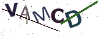

# IA Eng — modelos de visão computacional treinados localmente

Experimento para entender, na prática, como treinar uma IA **especialista em uma única tarefa**,
rodando em CPU comum, **sem GPU e sem custo de API**.

## Fase 1 · Leitura de texto distorcido (do zero, com dados sintéticos)

O `gerador.py` cria imagens de 5 caracteres com fonte, cor, rotação, ruído, riscos e desfoque aleatórios,
**já com a resposta certa**. Como a IA nunca vê a mesma imagem duas vezes, ela precisa aprender o padrão, não decorar.

| Exemplo | Resposta do modelo |
|---|---|
|  | `VAMCD` ✅ |
|  | (amostra do gerador) |
|  | (amostra do gerador) |

- Modelo: CNN com 4 blocos convolucionais e 5 saídas (uma por caractere), em PyTorch
- Treino: 512 mil imagens geradas, 61 min em CPU (i7 13ª geração)
- **Resultado em 1.000 imagens nunca vistas: 92,8% de acerto no texto inteiro e 98,4% por caractere**
- Modelo final: 13 MB

```bash
python gerador.py        # salva exemplos em amostras/
python treinar.py 4000   # treina e salva modelo.pt
python resolver.py imagem.png
```

## Fase 2 · Classificação de objetos em fotos de rua (ajuste fino)

Em vez de começar do zero, parte de uma rede que já enxerga (**MobileNetV3** pré-treinada no ImageNet)
e ensina só as classes novas: hidrante, semáforo, ônibus, bicicleta, carro, moto, placa de pare e "nada".

- Dados: recortes do dataset público [COCO](https://cocodataset.org) (`fotos/preparar.py` baixa e recorta)
- Classes equilibradas no treino com amostragem ponderada; 20% das fotos separadas para teste
- Treino: 16.694 recortes, 5 épocas, 29 min em CPU
- **Resultado em 4.109 imagens de teste: 95,4% de acerto geral**

| Classe | Acerto |
|---|---|
| Placa de pare | 99% |
| Hidrante | 98% |
| Semáforo | 97% |
| Nada | 97% |
| Carro | 94% |
| Ônibus | 93% |
| Bicicleta | 92% |
| Moto | 87% |

```bash
python fotos/preparar.py
python fotos/treinar.py 5
```

## O que este projeto mostra

- Gerar dados sintéticos rotulados por código, eliminando rotulagem manual
- Medir em dados separados do treino (generalização, não memorização)
- Ajuste fino (transfer learning) para obter bons resultados com poucos dados e sem GPU
- Modelos pequenos e especializados como alternativa barata a chamadas de LLM

## Requisitos

Python 3.12, `pip install -r requirements.txt` (PyTorch CPU). O gerador usa as fontes padrão do Windows.

---
Uso educacional. Os enigmas são gerados pelo próprio projeto; o objetivo é estudar treino de modelos.
